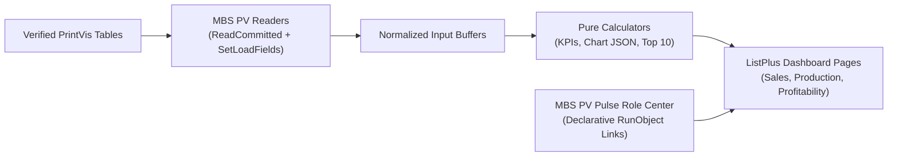

# MBS PrintVis Pulse — Implementation Specification (v2.1)

**Target Audience:** LLM Implementation Agent (AL / Business Central SaaS)  
**Writing Standard:** ASD-STE100 Simplified Technical English  
**Positioning:** Demo Per-Tenant Extension (PTE)  
**App Name:** `MBS PrintVis Pulse`  
**Repository Name:** `mbs-printvis-pulse`  
**Short Description:** Native Business Central dashboards for PrintVis. Tracks quote pipeline, production pulse, and job profitability inside Business Central without Power BI.  
**Publisher:** `MBS`  
**Object Prefix:** `MBS`  
**Target Platform:** Business Central SaaS (`Cloud`), minimum Platform `28.0.0.0`, minimum Application `28.0.0.0`, minimum Runtime `17.0` (verified on v28 and current stable wave v29).  
**AL-Go Projects:** `App` (`50000..50099`) and `App.Test` (`50100..50199`) only. Do not generate `.AL-Go` or `.github` files. Confirm the object ID range with the tenant owner. `50000..50099` is the most common PTE range and can collide with other PTEs in the same tenant.

---

## 1. Quick Example for Junior Developers and Consultants

A print shop receives a quote request for 50,000 folding cartons.

1. **Sales & Quote Pipeline:** The estimator issues a PrintVis quote for EUR 40,000. The case appears in **Current Open Quotes** until the customer accepts, rejects, or cancels it.
2. **Production Pulse:** The customer accepts the quote. PrintVis schedules press and die-cutter operations in `PVS Job Planning Unit`. If an incomplete operation is due today or tomorrow, it appears in **At-Risk Operations**.
3. **Job Profitability:** Operators post actual hours and paper to `PVS Job Costing Entry`. If posted actual cost exceeds the accepted cost estimate, the case appears in **Cases Over Estimate**.

`MBS PrintVis Pulse` exposes three dedicated Business Central `ListPlus` dashboard pages, searchable from Tell Me, plus an optional Role Center entry point.

---

## 2. P0 Gate: Verify PrintVis Contracts Before Coding (G0.1–G0.4)

API reference documents show candidate field mappings, not public AL contracts, field types, currency basis, or business semantics. Complete Gates G0.1 to G0.4 against the target `.app` symbol files and record all findings—including the exact Business Central version and PrintVis version tested—in `App/DATA-CONTRACT.md` before writing code. Also verify AL Test Toolkit availability in the target sandbox before relying on it for sandbox runs.

| Gate | Required Verification |
| --- | --- |
| **G0.1: Packages** | Extract exact `id`, `name`, `publisher`, and installed `version` for every PrintVis `.app` package that owns a used object. Do not assume one single dependency. Record the BC version and PrintVis version used for each verification. |
| **G0.2: Symbols and Joins** | For every used table, field, procedure, and page, record namespace, owning app, `Access`, `ObsoleteState`, field type/length, `FieldClass`, primary key, join cardinality, keys/SIFT, and enum/option values. Compile a small typed probe. Confirm `PVS Case.ID` type and full primary key; never guess `Code[20]` or use planning `Entry No.` alone as a source identity. Check whether `PVS Job Planning Unit` exposes an operation-level due date (E1). |
| **G0.3: Semantics and Drill-Down** | Confirm lifecycle flags, job-version/alternative rules, date meanings, currency basis (LCY vs. foreign currency), whether cost entries are posted and additive, and credit-memo sign conventions. Confirm exact Case Card page name/ID and verify record access under a normal sandbox user. Complete these specific checks: (E1) verify operation due date vs. `PVS Case."Due Date"` vs. `PVS Job Planning Unit."Requested Delivery Date"`; (E2) select and record one shipment promise field from `"Shipment Date Job"`, `"Promised Date Of Shipment"`, and `"Destination Delivery Date"`; (E5) verify whether labor cost appears in both `PVS Job Costing Entry` and `PVS Job Costing Labor Entry`; (E6) verify decision-date candidates (`Order Date`, rejected-quote `RejectDate`, `Status Changed On`); (S16) verify `DateTime` source fields and convert them with `DT2Date` in the user's time zone before period comparison. |
| **G0.4: Analysis Fallback** | If a core table is `Internal`, check if a vendor-supported PrintVis analysis table is `Public` and whether another extension can call its loader with matching grain, dates, identity, and currency. If not equivalent, defer that KPI or dashboard. Do not use dynamic bypasses, guessed substitutions, or same-tenant HTTP calls. Enforce these rules: (E3) forbid `powerbi` v2.0 objects (`ObsoleteState = Pending`, `ObsoleteTag = '23'`) and their source tables as data sources; (E4) forbid calling API-page procedures (`GetOpenQuote()`, `GetInvoicedAmount()`, `GetCreditMemosAmount()`) through a page variable (use them only as semantic reference); (E7) if an analysis table is used, measure `Rec.LoadData()` cost, verify pre-load filtering, and record results in `App/DATA-CONTRACT.md`. |

**Rule:** If a KPI's data contract is not verified, display `Unavailable`. Never ship an approximation under the original label.

---

## 3. Architecture & UI Wiring

### 3.1 Page Architecture
- **Role Center (`50010`):** Entry point only. Provide an optional `MBS PrintVis Pulse` profile with declarative `RunObject` links to the three dashboard pages. Do **not** place period switching, dashboard selection, or refresh logic in Role Center `OnAction` triggers (Business Central ignores `OnAction` on Role Center actions).
- **Dedicated Dashboard Pages (`50011`, `50012`, `50013`):** Build each dashboard as its own searchable `ListPlus` page (`UsageCategory = ReportsAndAnalysis`, `SourceTableTemporary = true`). Set `ApplicationArea = All` on all fields and actions, and `SourceTableTemporary = true` on all host pages and parts.
- **Host-Driven Composition:** Each `ListPlus` host owns the Period filter, Refresh action, and status header, and embeds:
  1. One shared KPI `CardPart` (`50014`) with dynamic captions bound via `CaptionClass = '3,' + Rec."KPI n Caption"` and notes shown as tooltips or fields below the cue group. Pages never hard-code KPI captions.
  2. One shared `MBS PV Chart Host` Control Add-In (locally packaged vanilla JS + CSS, zero CDN).
  3. One native exception `ListPart` (`50015..50017`) with an explicit read-only **Open PrintVis Case** action.

### 3.2 Single Bounded Snapshot, Telemetry, and PBT
- Each Refresh builds **one** bounded snapshot: dashboard type, active filters, business date, generated timestamp, KPI values, dynamic captions and notes, excluded counts, availability flags, up to 5 chart groups, and up to 10 sorted exception rows.
- The host supplies results explicitly to its parts via page procedures (`SetSnapshot(...)`, `ReplaceRows(...)`). Each `ListPart` owns its temporary `Rec` and replaces rows cleanly. Never rely on shared globals or implicit temporary-record sharing.
- **Telemetry:** On each Refresh, call `Session.LogMessage` with dashboard type, elapsed milliseconds, rows read per source, and availability per KPI. Use `DataClassification::SystemMetadata` and `TelemetryScope::ExtensionPublisher`.
- **Foreground First:** Start with bounded foreground execution on explicit Refresh and benchmark with telemetry. Adopt Page Background Tasks (PBT) only if measured latency justifies it and a sandbox spike proves the full serialized snapshot reaches every view. Note that `OnPageBackgroundTaskCompleted` can update controls (so a background result can be pushed to `MBS PV Chart Host`), while `CurrPage.Update(false)` has no effect there and temporary records do not cross sessions ([Microsoft Learn — Page Background Tasks](https://learn.microsoft.com/en-us/dynamics365/business-central/dev-itpro/developer/devenv-page-background-tasks)).

### 3.3 Reader / Calculator Separation and Error Handling
Split each dashboard's backend into three clear components:
1. **Reader (`MBS PV <Area> Reader`, `50030..50032`):** Reads verified PrintVis tables using `ReadIsolation(IsolationLevel::ReadCommitted)` and `SetLoadFields(...)` on normal fields only (handle FlowFields explicitly). After G0.2 records keys and SIFT, prefer `CalcSums`, `Count`, or Query objects over row loops for aggregate values; keep row loops for exception candidates. Dedupe exception rows to one row per case (Slices 1, 3) or per verified operation key (Slice 2) before insert. Return per-KPI source-availability flags.
2. **Reader Runner (`MBS PV Reader Runner`, `50034`):** Wraps each Reader inside `Codeunit.Run`. On `false`, the host sets all KPIs of that dashboard to `Unavailable`, clears exception rows, emits empty chart JSON, and logs `GetLastErrorText()` via telemetry (never shown raw to end users).
3. **Calculator (`MBS PV <Area> Calculator`, `50020..50022`):** Strictly pure and deterministic AL logic. Accepts Normalized Input Buffers, `FromDate`, `ToDate`, `BusinessDate`, `GeneratedAt`, currency/availability inputs, and writes the Snapshot, Top-10 exception rows, and Top-5 chart JSON. **Calculators must never call `Today`, `WorkDate`, `CurrentDateTime`, `Time`, or access the database.** Calculators copy `Unavailable` source flags through unchanged and compute only `Available` KPIs.

---

## 4. Approved KPI Definitions

**Availability Mapping:**
- Enum `MBS PV KPI Availability`: `Available` -> display `Value`; `NotApplicable` -> display `N/A`; `Unavailable` -> display `Unavailable`. Real zeros stay `0`.

**Date & Time Rules:**
- Use inclusive date ranges (a rolling 30-day preset includes the end date and the preceding 29 days).
- The `ListPlus` host supplies `BusinessDate := WorkDate()` and `GeneratedAt := CurrentDateTime()` for current-state metrics.
- Label current-state metrics `Current` with their refresh timestamp.
- Convert `DateTime` source fields with `DT2Date` in the user's time zone before period comparison.

### 4.1 Build Slice 1: Sales & Quote Pipeline (Build First)
- **Current Open Quotes (`Current`):** Count active, issued, still-open quote cases (one per case, not per version/alternative). Exclude converted, rejected, canceled, and archived cases per G0.3 rules.
- **Current Open Quote Value (`Current`):** Sum `Normalized Amount` across open quotes. The Reader fills `Normalized Amount` and sets `Normalized = true` only when the currency basis is verified in G0.3. If any open quote has `Normalized = false`, set KPI 2 to `NotApplicable`, emit empty chart JSON with `emptyMessage = 'Value unavailable: mixed or unverified currency.'`, rank exception rows by `Deadline` ascending then `Case Key Text` ascending, and set `List Caption = 'Open Quotes by Deadline'`.
- **Quote Hit Rate %:** `Won Decisions / (Won + Lost Decisions)` by verified outcome date in the selected period. Exclude undecided quotes and standalone orders. Verify decision-date candidates in G0.3 (`Order Date` for won, rejected-quote `RejectDate` for lost, `Status Changed On` — E6). If decision dates cannot be verified, use the fallback caption **Quote-Cohort Conversion to Date** (issued quotes in the quote-date cohort) and disclose in `KPI 3 Note` that open quotes remain in the denominator.
- **Chart (Top 5 Product Groups):** Current open quote `Normalized Amount` by product group (when currency is verified and single-basis).
- **Exception List (Top 10):** Open quotes ranked by `Normalized Amount` descending, then `Case Key Text` ascending (or by `Deadline` ascending under mixed currency). Show currency and quote deadline.

### 4.2 Build Slice 2: Production Pulse (Build Second)
- **On-Time Shipments %:** Shipped records in the period with nonblank verified actual shipment date and customer promise date: `Count(Actual <= Promise) / Count(Eligible Shipped)`. Record excluded count for blank dates. In `KPI 1 Note`, name the exact promise field selected in G0.3 (`"Shipment Date Job"`, `"Promised Date Of Shipment"`, or `"Destination Delivery Date"` — E2).
- **At-Risk Operations (`Current`):** Active, non-archived, incomplete operations on the current production version whose verified nonblank due date is `<= BusinessDate + 1`. Use this date precedence order (E1): (1) verified operation-level due date, (2) `PVS Case."Due Date"`, (3) `PVS Job Planning Unit."Requested Delivery Date"`. Expect the fallback caption **Incomplete Operations Near Requested Delivery** unless G0.2 confirms an operation-level due date. Show the chosen date source in `KPI 2 Note`.
- **In-Progress Operations (`Current`):** Count of started, incomplete eligible planning rows.
- **Chart (Top 5 Capacity Units):** Planned hours vs. recorded spent hours for one explicit operation cohort, using verified hour conversion, ranked by planned hours descending.
- **Exception List (Top 10):** At-risk operations sorted by due date ascending, then stable operation key ascending.

### 4.3 Build Slice 3: Job Profitability (Build Third)
- **Realized Margin %:** Only on cases closed in the selected period once the close event and financial completeness are verified in G0.3. Formula: `(Sum Net Invoiced Sales - Sum Posted Actual Cost) / Sum Net Invoiced Sales` using lifetime amounts on a common currency basis, including linked credit memos with verified signs. Return `NotApplicable` when net sales `<= 0`. Defer (`Unavailable`) if a reliable close cohort is unavailable.
- **Cases Over Estimate:** Compare posted actual cost against accepted quote/order cost estimate for the same case and sold version at equivalent scope and currency. Enforce the no-double-count rule verified in G0.3 between `PVS Job Costing Entry` and `PVS Job Costing Labor Entry` (E5). Count positive overruns once per case. Exclude missing/invalid baselines and store the excluded count in `Excluded Count 2`.
- **Current WIP (`Current`):** Include only if `PVS Case.WIP` is verified as monetary LCY WIP for an approved active population. Never sum component fields as a guess. Otherwise set `Unavailable` or replace with a verified closed-case count.
- **Chart (Top 5 Product Groups):** Accepted estimated cost vs. posted actual cost for the same eligible cohort as **Cases Over Estimate**, ranked by total actual cost descending.
- **Exception List (Top 10):** Cases ranked by largest positive cost overrun descending (`Sort Amount = -Overrun`), then stable case key ascending.

---

## 5. Folder Structure & Object Inventory (`App` and `App.Test`)

### Repository Root Files
- `README.md`
- `LICENSE` (MIT)
- `App/`
- `App.Test/`

### `App/` (`50000..50099`, Namespace root: `MBS.PrintVisPulse`)

All buffer tables (`50000..50007`) use `TableType = Temporary` and `Access = Internal`.

```text
App/
├── app.json
├── DATA-CONTRACT.md
├── README.md
└── src/
    ├── ControlAddIn/
    │   ├── MBSPVChartHost.ControlAddIn.al
    │   └── scripts/
    │       ├── startup.js
    │       ├── chartHost.js
    │       └── chartHost.css
    ├── Buffers/
    │   ├── MBSPVSnapshotBuffer.Table.al            (50000) PK: "Primary Key"
    │   ├── MBSPVQuoteInputBuffer.Table.al          (50001) PK: "Case Key Text"
    │   ├── MBSPVOpenQuoteRow.Table.al              (50002) PK: "Case Key Text"
    │   ├── MBSPVProdInputBuffer.Table.al           (50003) PK: "Operation Key Text"
    │   ├── MBSPVProdRiskRow.Table.al               (50004) PK: "Operation Key Text"
    │   ├── MBSPVProfitInputBuffer.Table.al         (50005) PK: "Case Key Text"
    │   ├── MBSPVProfitOverrunRow.Table.al          (50006) PK: "Case Key Text"
    │   └── MBSPVChartGroupBuffer.Table.al          (50007) PK: "Group Code"
    ├── Calculators/
    │   ├── MBSPVSalesCalculator.Codeunit.al        (50020)
    │   ├── MBSPVProdCalculator.Codeunit.al         (50021)
    │   └── MBSPVProfitCalculator.Codeunit.al       (50022)
    ├── Readers/
    │   ├── MBSPVSalesReader.Codeunit.al            (50030)
    │   ├── MBSPVProdReader.Codeunit.al             (50031)
    │   ├── MBSPVProfitReader.Codeunit.al           (50032)
    │   ├── MBSPVDrillDownMgt.Codeunit.al           (50033)
    │   └── MBSPVReaderRunner.Codeunit.al           (50034)
    ├── Pages/
    │   ├── MBSPVPulseRoleCenter.Page.al            (50010)
    │   ├── MBSPVSalesDashboard.Page.al             (50011)
    │   ├── MBSPVProdDashboard.Page.al              (50012)
    │   ├── MBSPVProfitDashboard.Page.al            (50013)
    │   ├── MBSPVKpiCuePart.Page.al                 (50014)
    │   ├── MBSPVSalesListPart.Page.al              (50015)
    │   ├── MBSPVProdListPart.Page.al               (50016)
    │   ├── MBSPVProfitListPart.Page.al             (50017)
    │   └── MBSPVPulseProfile.Profile.al
    ├── Enums/
    │   ├── MBSPVDashboardType.Enum.al              (50040)
    │   ├── MBSPVPeriodFilter.Enum.al               (50041)
    │   └── MBSPVKpiAvailability.Enum.al            (50042)
    └── Permissions/
        └── MBSPVPulseUsers.PermissionSet.al        (50050)
```

**Key Buffer Fields:**
- `50000 "MBS PV Snapshot Buffer"`: `"Primary Key"`, `"Generated At"`, `"Period From"`, `"Period To"`, `"Business Date"`, `"List Caption"` (`Text[80]`), `"Chart Caption"` (`Text[80]`), and for `n = 1..3`: `"KPI n Availability"` (`Enum "MBS PV KPI Availability"`), `"KPI n Int"` (`Integer`), `"KPI n Decimal"` (`Decimal`), `"KPI n Caption"` (`Text[80]`), `"KPI n Note"` (`Text[250]`), `"Excluded Count n"` (`Integer`).
- `50001 "MBS PV Quote Input Buffer"`: `"Case Key Text"`, `"Source SystemId"`, `"Quote No."`, `"Customer Name"`, `"Product Group"`, `"Currency Code"`, `"Deadline"`, `"Quoted Amount"`, `"Normalized Amount"` (`Decimal`), `"Normalized"` (`Boolean`), `"Is Issued Quote"`, `"Is Archived"`, `"Is Canceled"`, `"Outcome"` (`Option Open,Won,Lost`), `"Decision Date"`.
- Exception row buffers (`50002`, `50004`, `50006`): Each declares its primary key (`"Case Key Text"` for Slices 1 and 3; `"Operation Key Text"` for Slice 2), `"Source SystemId"`, `"Sort Amount"` (`Decimal`), `"Display Rank"` (`Integer`), and secondary key `Rank("Sort Amount", <PK>)`. Readers dedupe to one row per primary key before insert.

### `App.Test/` (`50100..50199`, Namespace root: `MBS.PrintVisPulse.Test`)

```text
App.Test/
├── app.json
├── README.md
└── src/
    ├── Helpers/
    │   └── MBSPVTestFixtures.Codeunit.al           (50100)
    └── Tests/
        ├── MBSPVSalesCalcTests.Codeunit.al         (50101)
        ├── MBSPVProdCalcTests.Codeunit.al          (50102)
        └── MBSPVProfitCalcTests.Codeunit.al        (50103)
```

---

## 6. Compilable AL & Control Add-In Blueprints (Slice 1 Reference)

Implement Slice 1 (Sales) end-to-end first, validate in sandbox, then replicate the pattern for Slice 2 (Production) and Slice 3 (Profitability). Every snippet below compiles against runtime 17.0 with zero CodeCop, UICop, and PTECop warnings.

### 6.1 Manifest Rules (`App/app.json` and `App.Test/app.json`)
- Set `"platform": "28.0.0.0"`, `"application": "28.0.0.0"`, `"runtime": "17.0"`, `"target": "Cloud"`, `"features": ["NoImplicitWith"]` as the minimum target.
- Populate `App/app.json` `dependencies` with every PrintVis package recorded in G0.1.
- Add `internalsVisibleTo` in `App/app.json` with `id`, `name`, and `publisher` for `App.Test`. Note: `internalsVisibleTo` is acceptable for a PTE, not for an AppSource submission.
- Verify Microsoft test library dependency IDs and versions (`Library Assert`, `Any`, `Test Runner`) against target symbols in `App.Test/app.json`.

### 6.2 Safe Control Add-In (`MBSPVChartHost.ControlAddIn.al`)

```al
controladdin "MBS PV Chart Host"
{
    StartupScript = 'src/ControlAddIn/scripts/startup.js';
    Scripts = 'src/ControlAddIn/scripts/chartHost.js';
    StyleSheets = 'src/ControlAddIn/scripts/chartHost.css';
    RequestedHeight = 280;
    MinimumHeight = 240;
    HorizontalStretch = true;
    VerticalStretch = false;

    event OnControlReady();
    procedure RenderBarChart(ChartJson: Text);
}
```

**`src/ControlAddIn/scripts/startup.js`:**
```javascript
Microsoft.Dynamics.NAV.InvokeExtensibilityMethod('OnControlReady', []);
```

**`src/ControlAddIn/scripts/chartHost.js`:**
```javascript
window.RenderBarChart = function (chartJson) {
    const root = document.getElementById('controlAddIn');
    if (!root) return;
    root.replaceChildren();

    let payload;
    try { payload = JSON.parse(chartJson || '{}'); } catch { payload = {}; }
    const toNum = (v) => (v === null || v === undefined ? NaN : Number(v));
    const labels = Array.isArray(payload.labels) ? payload.labels : [];
    const s1 = Array.isArray(payload.series1) ? payload.series1.map(toNum) : [];
    const s2 = Array.isArray(payload.series2) ? payload.series2.map(toNum) : [];

    if (!labels.length) {
        const empty = document.createElement('div');
        empty.className = 'mbs-empty';
        empty.textContent = payload.emptyMessage || 'No data for selected period.';
        root.appendChild(empty);
        return;
    }

    const numericValues = [...s1, ...s2].filter((v) => Number.isFinite(v)).map((v) => Math.abs(v));
    const maxVal = Math.max(1, ...numericValues);

    const chart = document.createElement('div');
    chart.className = 'mbs-chart';

    const header = document.createElement('div');
    header.className = 'mbs-header';
    const title = document.createElement('span');
    title.className = 'mbs-title';
    title.textContent = payload.title || '';
    header.appendChild(title);
    chart.appendChild(header);

    labels.forEach((lbl, i) => {
        const row = document.createElement('div');
        row.className = 'mbs-row';

        const labelEl = document.createElement('div');
        labelEl.className = 'mbs-label';
        labelEl.textContent = String(lbl);
        labelEl.title = String(lbl);
        row.appendChild(labelEl);

        const bars = document.createElement('div');
        bars.className = 'mbs-bars';

        [s1[i], s2[i]].forEach((val, idx) => {
            if (!Number.isFinite(val)) return;
            const bar = document.createElement('div');
            bar.className = 'mbs-bar ' + (idx === 0 ? 's1' : 's2') + (val < 0 ? ' neg' : '');
            bar.style.width = Math.round((Math.abs(val) / maxVal) * 100) + '%';
            const seriesName = idx === 0 ? (payload.series1Label || '') : (payload.series2Label || '');
            bar.title = seriesName + ': ' + val;
            bars.appendChild(bar);
        });

        row.appendChild(bars);
        chart.appendChild(row);
    });

    root.appendChild(chart);
};
```

**Host readiness rule:** Store `ChartReady: Boolean` and `LastChartJson: Text` on each `ListPlus` host. Render when both are present, regardless of arrival order, and replay `LastChartJson` if `OnControlReady` fires again after add-in recreation.

### 6.3 Complete Ranked Buffers and Pure Sales Calculator

```al
namespace MBS.PrintVisPulse.Buffers;

table 50002 "MBS PV Open Quote Row"
{
    Access = Internal;
    Caption = 'MBS PV Open Quote Row';
    TableType = Temporary;
    DataClassification = CustomerContent;

    fields
    {
        field(1; "Case Key Text"; Text[100]) { Caption = 'Case Key'; }
        field(2; "Source SystemId"; Guid) { Caption = 'Source SystemId'; }
        field(3; "Quote No."; Code[20]) { Caption = 'Quote No.'; }
        field(4; "Customer Name"; Text[100]) { Caption = 'Customer Name'; }
        field(5; "Product Group"; Code[20]) { Caption = 'Product Group'; }
        field(6; "Currency Code"; Code[10]) { Caption = 'Currency Code'; }
        field(7; Deadline; Date) { Caption = 'Deadline'; }
        field(8; "Quoted Amount"; Decimal) { Caption = 'Quoted Amount'; }
        field(9; "Normalized Amount"; Decimal) { Caption = 'Normalized Amount'; }
        field(10; "Sort Amount"; Decimal) { Caption = 'Sort Amount'; }
        field(11; "Display Rank"; Integer) { Caption = 'Display Rank'; }
    }

    keys
    {
        key(PK; "Case Key Text") { Clustered = true; }
        key(Rank; "Sort Amount", "Case Key Text") { }
        key(ByDeadline; Deadline, "Case Key Text") { }
    }
}
```

```al
namespace MBS.PrintVisPulse.Buffers;

table 50007 "MBS PV Chart Group Buffer"
{
    Access = Internal;
    Caption = 'MBS PV Chart Group Buffer';
    TableType = Temporary;
    DataClassification = SystemMetadata;

    fields
    {
        field(1; "Group Code"; Code[20]) { Caption = 'Group Code'; }
        field(2; "Series 1"; Decimal) { Caption = 'Series 1'; }
        field(3; "Series 2"; Decimal) { Caption = 'Series 2'; }
        field(4; "Sort Amount"; Decimal) { Caption = 'Sort Amount'; }
        field(5; "Display Rank"; Integer) { Caption = 'Display Rank'; }
    }

    keys
    {
        key(PK; "Group Code") { Clustered = true; }
        key(Rank; "Sort Amount", "Group Code") { }
    }
}
```

```al
namespace MBS.PrintVisPulse.Calculators;

using MBS.PrintVisPulse.Buffers;
using MBS.PrintVisPulse.Enums;

codeunit 50020 "MBS PV Sales Calculator"
{
    Access = Internal;

    var
        OpenQuotesCaptionLbl: Label 'Current Open Quotes';
        OpenQuoteValueCaptionLbl: Label 'Current Open Quote Value';
        HitRateCaptionLbl: Label 'Quote Hit Rate %';
        ChartTitleLbl: Label 'Current Open Quote Value by Product Group';
        Series1Lbl: Label 'Open Quote Value';
        ListByValueLbl: Label 'Top Open Quotes by Value';
        ListByDeadlineLbl: Label 'Open Quotes by Deadline';
        MixedCurrencyMsgLbl: Label 'Value unavailable: mixed or unverified currency.';
        NoDataMsgLbl: Label 'No data for selected period.';
        SourceUnavailableMsgLbl: Label 'PrintVis source data is unavailable.';

    procedure Calculate(
        var InputRows: Record "MBS PV Quote Input Buffer" temporary;
        FromDate: Date;
        ToDate: Date;
        BusinessDate: Date;
        GeneratedAt: DateTime;
        BaseCurrencyCode: Code[10];
        SourceAvailable: Boolean;
        var Snapshot: Record "MBS PV Snapshot Buffer" temporary;
        var TopQuotes: Record "MBS PV Open Quote Row" temporary;
        var Groups: Record "MBS PV Chart Group Buffer" temporary;
        var ChartJson: Text)
    var
        OpenCount: Integer;
        OpenValue: Decimal;
        MixedOrUnverifiedCurrency: Boolean;
        WonCount: Integer;
        LostCount: Integer;
    begin
        Snapshot.DeleteAll();
        TopQuotes.DeleteAll();
        Groups.DeleteAll();

        Snapshot.Init();
        Snapshot."Primary Key" := 'SALES';
        Snapshot."Generated At" := GeneratedAt;
        Snapshot."Business Date" := BusinessDate;
        Snapshot."Period From" := FromDate;
        Snapshot."Period To" := ToDate;
        Snapshot."KPI 1 Caption" := OpenQuotesCaptionLbl;
        Snapshot."KPI 2 Caption" := OpenQuoteValueCaptionLbl;
        Snapshot."KPI 3 Caption" := HitRateCaptionLbl;
        Snapshot."Chart Caption" := ChartTitleLbl;
        Snapshot."List Caption" := ListByValueLbl;

        if not SourceAvailable then begin
            Snapshot."KPI 1 Availability" := Enum::"MBS PV KPI Availability"::Unavailable;
            Snapshot."KPI 2 Availability" := Enum::"MBS PV KPI Availability"::Unavailable;
            Snapshot."KPI 3 Availability" := Enum::"MBS PV KPI Availability"::Unavailable;
            Snapshot.Insert();
            ChartJson := BuildTop5ChartJson(ChartTitleLbl, Series1Lbl, SourceUnavailableMsgLbl, Groups);
            exit;
        end;

        if InputRows.FindSet() then
            repeat
                if IsOpenQuote(InputRows) then begin
                    OpenCount += 1;
                    if (not InputRows.Normalized) or ((BaseCurrencyCode <> '') and (InputRows."Currency Code" <> '') and (InputRows."Currency Code" <> BaseCurrencyCode)) then
                        MixedOrUnverifiedCurrency := true
                    else begin
                        OpenValue += InputRows."Normalized Amount";
                        AddGroupTotal(Groups, InputRows."Product Group", InputRows."Normalized Amount");
                    end;
                    InsertCandidateRow(TopQuotes, InputRows);
                end;

                if IsDecisionInPeriod(InputRows, FromDate, ToDate) then
                    if InputRows.Outcome = InputRows.Outcome::Won then
                        WonCount += 1
                    else
                        if InputRows.Outcome = InputRows.Outcome::Lost then
                            LostCount += 1;
            until InputRows.Next() = 0;

        Snapshot."KPI 1 Availability" := Enum::"MBS PV KPI Availability"::Available;
        Snapshot."KPI 1 Int" := OpenCount;

        if MixedOrUnverifiedCurrency then begin
            Snapshot."KPI 2 Availability" := Enum::"MBS PV KPI Availability"::NotApplicable;
            Snapshot."KPI 2 Note" := MixedCurrencyMsgLbl;
            Snapshot."List Caption" := ListByDeadlineLbl;
            Groups.DeleteAll();
            TrimToTop10(TopQuotes, true);
            ChartJson := BuildTop5ChartJson(ChartTitleLbl, Series1Lbl, MixedCurrencyMsgLbl, Groups);
        end else begin
            Snapshot."KPI 2 Availability" := Enum::"MBS PV KPI Availability"::Available;
            Snapshot."KPI 2 Decimal" := OpenValue;
            TrimToTop10(TopQuotes, false);
            ChartJson := BuildTop5ChartJson(ChartTitleLbl, Series1Lbl, NoDataMsgLbl, Groups);
        end;

        if (WonCount + LostCount) = 0 then
            Snapshot."KPI 3 Availability" := Enum::"MBS PV KPI Availability"::NotApplicable
        else begin
            Snapshot."KPI 3 Availability" := Enum::"MBS PV KPI Availability"::Available;
            Snapshot."KPI 3 Decimal" := Round((WonCount / (WonCount + LostCount)) * 100, 0.1);
        end;

        Snapshot.Insert();
    end;

    local procedure IsOpenQuote(var Row: Record "MBS PV Quote Input Buffer" temporary): Boolean
    begin
        exit(Row."Is Issued Quote" and (not Row."Is Archived") and (not Row."Is Canceled") and (Row.Outcome = Row.Outcome::Open));
    end;

    local procedure IsDecisionInPeriod(var Row: Record "MBS PV Quote Input Buffer" temporary; FromDate: Date; ToDate: Date): Boolean
    begin
        exit(Row."Is Issued Quote" and (Row."Decision Date" >= FromDate) and (Row."Decision Date" <= ToDate));
    end;

    local procedure AddGroupTotal(var Groups: Record "MBS PV Chart Group Buffer" temporary; GroupCode: Code[20]; Amount: Decimal)
    begin
        if GroupCode = '' then
            GroupCode := 'UNASSIGNED';
        if not Groups.Get(GroupCode) then begin
            Groups.Init();
            Groups."Group Code" := GroupCode;
            Groups.Insert();
        end;
        Groups."Series 1" += Amount;
        Groups."Sort Amount" := -Groups."Series 1";
        Groups.Modify();
    end;

    local procedure InsertCandidateRow(var TopQuotes: Record "MBS PV Open Quote Row" temporary; var InputRow: Record "MBS PV Quote Input Buffer" temporary)
    begin
        TopQuotes.Init();
        TopQuotes."Case Key Text" := InputRow."Case Key Text";
        TopQuotes."Source SystemId" := InputRow."Source SystemId";
        TopQuotes."Quote No." := InputRow."Quote No.";
        TopQuotes."Customer Name" := InputRow."Customer Name";
        TopQuotes."Product Group" := InputRow."Product Group";
        TopQuotes."Currency Code" := InputRow."Currency Code";
        TopQuotes.Deadline := InputRow.Deadline;
        TopQuotes."Quoted Amount" := InputRow."Quoted Amount";
        TopQuotes."Normalized Amount" := InputRow."Normalized Amount";
        TopQuotes."Sort Amount" := -InputRow."Normalized Amount";
        TopQuotes.Insert();
    end;

    local procedure TrimToTop10(var TopQuotes: Record "MBS PV Open Quote Row" temporary; RankByDeadline: Boolean)
    var
        RankNo: Integer;
    begin
        TopQuotes.Reset();
        if RankByDeadline then
            TopQuotes.SetCurrentKey(Deadline, "Case Key Text")
        else
            TopQuotes.SetCurrentKey("Sort Amount", "Case Key Text");

        if TopQuotes.FindSet() then
            repeat
                RankNo += 1;
                if RankByDeadline then
                    TopQuotes."Sort Amount" := 0;
                TopQuotes."Display Rank" := RankNo;
                TopQuotes.Modify();
            until TopQuotes.Next() = 0;

        TopQuotes.SetFilter("Display Rank", '>%1', 10);
        TopQuotes.DeleteAll();
        TopQuotes.Reset();
    end;

    local procedure BuildTop5ChartJson(TitleText: Text; Series1Label: Text; EmptyMessage: Text; var Groups: Record "MBS PV Chart Group Buffer" temporary): Text
    var
        RootObj: JsonObject;
        LabelsArr: JsonArray;
        ValuesArr: JsonArray;
        RankNo: Integer;
        ResultText: Text;
    begin
        Groups.Reset();
        Groups.SetCurrentKey("Sort Amount", "Group Code");
        if Groups.FindSet() then
            repeat
                RankNo += 1;
                LabelsArr.Add(Groups."Group Code");
                ValuesArr.Add(Groups."Series 1");
            until (Groups.Next() = 0) or (RankNo = 5);

        RootObj.Add('title', TitleText);
        RootObj.Add('series1Label', Series1Label);
        RootObj.Add('emptyMessage', EmptyMessage);
        RootObj.Add('labels', LabelsArr);
        RootObj.Add('series1', ValuesArr);
        RootObj.WriteTo(ResultText);
        exit(ResultText);
    end;
}
```

### 6.4 Drill-Down & Permission Set Rules
- **Drill-Down (`MBS PV DrillDown Mgt.`, `50033`):** Carry the verified same-company `SystemId` (or full typed primary key from G0.2) on every exception buffer row. Never reuse a temporary analysis buffer's `SystemId`. Verify record existence and read permission before calling `Page.Run(Page::"<VERIFIED_CASE_CARD>", PvsCase)`.
- **Permission Set (`MBS PV Pulse Users`, `50050`):** Set `Assignable = true`. Enumerate explicit `X` execute permissions for each Pulse object (pages `50010..50017`, codeunits `50020..50022` and `50030..50034`, temporary tables `50000..50007`). Do **not** declare `tabledata` permissions for temporary buffer tables (`50000..50007`), do **not** list enums, profile, or control add-in, and do **not** use a numeric range shorthand. Rely on the user's existing PrintVis permission sets for vendor table data and PrintVis UI pages.

### 6.5 Pure Unit Tests (`App.Test`, `50100..50103`)

Unit tests run in the AL-Go container pipeline. The SaaS sandbox is for acceptance testing only. Tests call the **real calculators** with normalized fixture inputs from `MBS PV Test Fixtures` (`50100`).

| Codeunit | ID | Minimum Required Test Cases |
| --- | --- | --- |
| `MBS PV Sales Calc Tests` | `50101` | Open, won, rejected, canceled, revised, never-issued quotes; standalone order; decision date on period boundary; mixed/unverified currency (`NotApplicable` KPI 2, empty chart with M1 message, deadline sort, `Open Quotes by Deadline` caption); period with zero decisions (`NotApplicable` hit rate); `SourceAvailable = false` (`Unavailable`, not `0`). |
| `MBS PV Prod Calc Tests` | `50102` | On-time and late shipments; each promise-date candidate blank (E2); split shipment; overlapping entry numbers; active vs. superseded versions; missing due date; hour conversion; `SourceAvailable = false`. |
| `MBS PV Profit Calc Tests` | `50103` | Credit memo sign; zero/negative net sales (`NotApplicable`); cost posted before close period; alternative/superseded job version; missing estimate exclusion; multi-job case; labor present in both `PVS Job Costing Entry` and `PVS Job Costing Labor Entry` (E5 no-double-count); tied overrun rank; `SourceAvailable = false`. |

---

## 7. Sandbox Acceptance Checklist

1. Compile `App` and `App.Test` with CodeCop, UICop, and PTECop enabled. Zero warnings. Record BC and PrintVis versions.
2. Run acceptance on a v28 sandbox and on the current stable wave (v29) sandbox.
3. Reconcile one representative case set per dashboard against PrintVis. Log variance in `App/DATA-CONTRACT.md`.
4. Test under a normal PrintVis user and a restricted user. Denied records never appear in KPIs, charts, lists, or drill-downs.
5. Test two companies, empty periods, `N/A` and `Unavailable` states, reader failure (M7), mixed currency (M1), rapid filter changes, add-in recreation, and `Open PrintVis Case`.
6. Record elapsed time and rows read (telemetry, S6) for the largest enabled period before you consider PBT.

---

## 8. Ready-to-Use Documentation Drafts (ASD-STE100 Style)

Update these drafts after sandbox verification so they describe only verified, working behavior.

### Draft A: Root `README.md`

```markdown
# MBS PrintVis Pulse

A Microsoft Dynamics 365 Business Central Demo Per-Tenant Extension (PTE) that adds three native PrintVis dashboards inside Business Central. Built for Business Central 28.0 or later (`runtime 17.0`) with two AL projects: `App` and `App.Test`.

## Problem

PrintVis stores estimating, production, and job costing data in Business Central. Users often switch to Power BI or open many case cards to answer three daily questions:

- Which open quotes need follow-up?
- Which operations are behind schedule?
- Which print jobs are over estimate?

This app answers those questions inside Business Central with no external BI tool.

## Why this matters

- **Native Business Central UI:** Uses dedicated searchable `ListPlus` dashboard pages, native KPIs, native exception lists, and one locally packaged vanilla-JS Chart Control Add-In.
- **No external dependencies:** Runs inside Business Central SaaS with zero CDN calls and no Power BI setup.
- **Testable AL architecture:** Separates PrintVis readers from pure calculation codeunits so automated tests verify real KPI formulas.

## Architecture



**Boundaries:**

- Read-only against PrintVis data. Pulse never modifies PrintVis tables.
- Permissions: Pulse grants execute rights on Pulse objects; PrintVis data access follows the user's PrintVis permission sets.
- Unverified KPIs display `Unavailable`; undefined ratios display `N/A`.
- Target: `Cloud` (SaaS), Business Central 28.0 or later (`runtime 17.0`).

See [`App/README.md`](App/README.md) and `App/DATA-CONTRACT.md` for verified PrintVis mappings and object lists.

## Demo steps

**Prerequisites:** A Business Central 28.0 or later SaaS sandbox with the PrintVis packages recorded in `App/DATA-CONTRACT.md` installed and `App` published.

1. Open Tell Me (`Alt+Q`) and search for **MBS PrintVis Sales Dashboard** (or switch Role to **MBS PrintVis Pulse**).
2. Select a period filter and choose **Refresh**.
3. Review the KPI cues, top-5 chart, and top-10 exception list.
4. Select an exception row and choose **Open PrintVis Case**.

## What is intentionally simple

- Three focused dashboards delivered in slices (Sales, then Production, then Profitability).
- Bounded foreground refresh first; Page Background Tasks added only where benchmarked latency requires it.
- One locally packaged vanilla-JS chart control using DOM text APIs.

## Risks and limits

- **Demo PTE:** Not packaged or validated for AppSource.
- **PrintVis dependency:** Requires verified PrintVis symbols and access modifiers recorded in `App/DATA-CONTRACT.md`.
- **Single-company view:** Metrics reflect the current Business Central company.

## Repository structure

| Path | App / File | Purpose | Object IDs |
| --- | --- | --- | --- |
| [`App`](App/README.md) | MBS PrintVis Pulse | Dashboards, readers, calculators, chart add-in, Role Center | `50000..50099` |
| [`App.Test`](App.Test/README.md) | MBS PrintVis Pulse Test | Pure unit tests against production calculators | `50100..50199` |
| [`LICENSE`](LICENSE) | MIT License | Repository license | — |

## Notes

- **Requirements:** Business Central 28.0 or later (`runtime 17.0`) and the PrintVis packages recorded in `App/DATA-CONTRACT.md`.
- **License:** [MIT](LICENSE).
```

---

### Draft B: `App/README.md`

```markdown
# MBS PrintVis Pulse

Main Business Central Demo PTE for native PrintVis performance dashboards. Part of the [MBS PrintVis Pulse](../README.md) repository.

## Architecture

- **Readers (`50030..50032`) & Runner (`50034`):** Read verified PrintVis tables using `ReadIsolation::ReadCommitted` and `SetLoadFields` on normal fields, wrapped in `Codeunit.Run` so reader errors degrade cleanly to `Unavailable`.
- **Calculators (`50020..50022`):** Pure, deterministic AL logic that computes KPIs, dynamic captions, `N/A`/`Unavailable` states, top-5 chart JSON, and top-10 ranked exception rows into one bounded snapshot.
- **Pages (`50010..50017`):** One optional Role Center (`50010`) with declarative links, plus three searchable `ListPlus` dashboard hosts (`50011..50013`) that coordinate the shared KPI `CardPart` (`50014`), `MBS PV Chart Host`, and exception `ListParts` (`50015..50017`).
- **Access:** Buffers, readers, runner, and calculators are `Access = Internal` and exposed to `App.Test` via `internalsVisibleTo`.

### Object Summary

| Range | Area | Objects |
| --- | --- | --- |
| `50000..50007` | Buffers | Snapshot buffer, normalized input buffers, exception list rows, chart group buffer |
| `50010..50017` | Pages | Role Center, 3 `ListPlus` dashboards, shared KPI `CardPart`, 3 exception `ListParts` |
| `50020..50022` | Calculators | Pure Sales, Production, and Profitability calculators |
| `50030..50034` | Readers & Navigation | PrintVis readers, read-only Case drill-down manager, reader runner |
| `50040..50042` | Enums | Dashboard type, period filter, KPI availability |
| `50050` | Permissions | `MBS PV Pulse Users` (explicit execute rights on Pulse objects) |
| Control Add-In | Visualization | `MBS PV Chart Host` (local vanilla JS + CSS, `StartupScript`) |

## Notes

- **Object ID range:** `50000..50099` (confirm with tenant owner to avoid PTE collisions)
- **Data contract:** See `App/DATA-CONTRACT.md` for verified PrintVis symbols, filters, joins, and sandbox benchmarks.
- **License:** [MIT](../LICENSE)
```

---

### Draft C: `App.Test/README.md`

```markdown
# MBS PrintVis Pulse - Test

Automated unit test suite for [MBS PrintVis Pulse](../README.md).

## Problem

KPI formulas, period boundaries, currency rules, `N/A` and `Unavailable` guards, and tie-break rankings can regress during refactoring or BC/PrintVis upgrades.

## Architecture

- **Pure calculator testing:** Tests feed normalized fixture rows from `MBS PV Test Fixtures` (`50100`) directly into the production calculator codeunits (`50020..50022`).
- **Execution environment:** Unit tests run in the AL-Go container pipeline. The SaaS sandbox is used for acceptance checks only.
- **Access:** Calls internal calculator and buffer objects via `internalsVisibleTo`.

### Test Codeunits

| Codeunit | ID | Focus |
| --- | --- | --- |
| `MBS PV Test Fixtures` | `50100` | Normalized input row builders |
| `MBS PV Sales Calc Tests` | `50101` | Open quotes, mixed currencies, decision dates, `N/A`, `Unavailable` |
| `MBS PV Prod Calc Tests` | `50102` | OTD %, blank promise dates, due-date risk, hour conversion, `Unavailable` |
| `MBS PV Profit Calc Tests` | `50103` | Realized margin %, credit memos, zero-sales `N/A`, no-double-count labor, overruns |

## Running Tests

1. Run the AL-Go CI container pipeline to publish `App` and `App.Test` and execute codeunits `50101..50103`.
2. For manual sandbox checks, confirm AL Test Toolkit availability first.

## Notes

- **Object ID range:** `50100..50199`
- **Dependencies:** `MBS PrintVis Pulse`, Microsoft `Library Assert`, `Any`, `Test Runner` (versions verified against target symbols).
- **License:** [MIT](../LICENSE)
```

---

## 9. Change Log (v2.0 → v2.1)

- **M1:** Added `Normalized Amount` and `Normalized` to `MBS PV Quote Input Buffer` (`50001`). Enforced single currency basis across KPI 2, chart JSON (empty with explicit message on mixed currency), and exception list fallback sort (`Deadline` ascending, caption `Open Quotes by Deadline`). Added matching test cases.
- **M2:** Added `BusinessDate` and `GeneratedAt` parameters to all `Calculate` procedures; forbade `Today`, `WorkDate`, `CurrentDateTime`, `Time`, and DB access inside calculators; documented host `WorkDate()` rule.
- **M3:** Replaced all stub procedures (`TrimToTop10`, `BuildTop5ChartJson`), `// Implementator:` comments, and unused variables in Section 6.3 with complete, zero-warning AL code.
- **M4:** Implemented negated `Sort Amount` (`-Normalized Amount`) with secondary key `Rank("Sort Amount", <PK>)` and temporary `MBS PV Chart Group Buffer` (`50007`) for deterministic descending value + ascending tie-break sorting.
- **M5:** Set `28.0.0.0` / `runtime 17.0` as minimum target, added v29 acceptance requirement in Section 7, required recording BC/PrintVis versions in `DATA-CONTRACT.md`, and updated READMEs to "Business Central 28.0 or later".
- **M6:** Added dynamic captions (`KPI n Caption`, `List Caption`, `Chart Caption`), notes (`KPI n Note`), and `Excluded Count n` to `MBS PV Snapshot Buffer` (`50000`), bound via `CaptionClass = '3,' + Rec."KPI n Caption"` in `MBS PV KPI Cue Part` (`50014`).
- **M7:** Added `MBS PV Reader Runner` (`50034`) wrapping Readers in `Codeunit.Run`, added `SourceAvailable` propagation to `Unavailable`, and added corresponding unit tests.
- **M8:** Updated Section 5 object inventory with `MBS PV Chart Group Buffer` (`50007`), `MBS PV Reader Runner` (`50034`), and all new M1/M6 fields.
- **E1–E7:** Added all seven PrintVis evidence gaps as explicit G0.3/G0.4 checks and Section 4 expected behaviors (operation due-date precedence, shipment promise-date selection, `powerbi` v2.0 ban, API-page procedure ban, labor cost no-double-count rule, decision-date candidates, and `LoadData()` benchmarking).
- **S1–S16:** Applied all sixteen SHOULD improvements: temporary buffer rules & no `tabledata` permissions (S1), explicit object execute permissions (S2), PTE ID-range collision warning (S3), explicit exception buffer PKs & Reader dedupe rule (S4), `CalcSums`/`Count`/Query preference (S5), Refresh telemetry via `Session.LogMessage` (S6), PBT control-update note (S7), AL-Go container pipeline vs. SaaS sandbox test split (S8), PrintVis package wording (S9), `LICENSE` in repo structure (S10), unified Demo PTE positioning (S11), availability enum-to-display mapping (S12), `internalsVisibleTo` PTE note (S13), `ApplicationArea = All` & `SourceTableTemporary = true` (S14), safe `null`/`undefined` handling in `chartHost.js` (S15), and `DT2Date` time-zone rule (S16).
