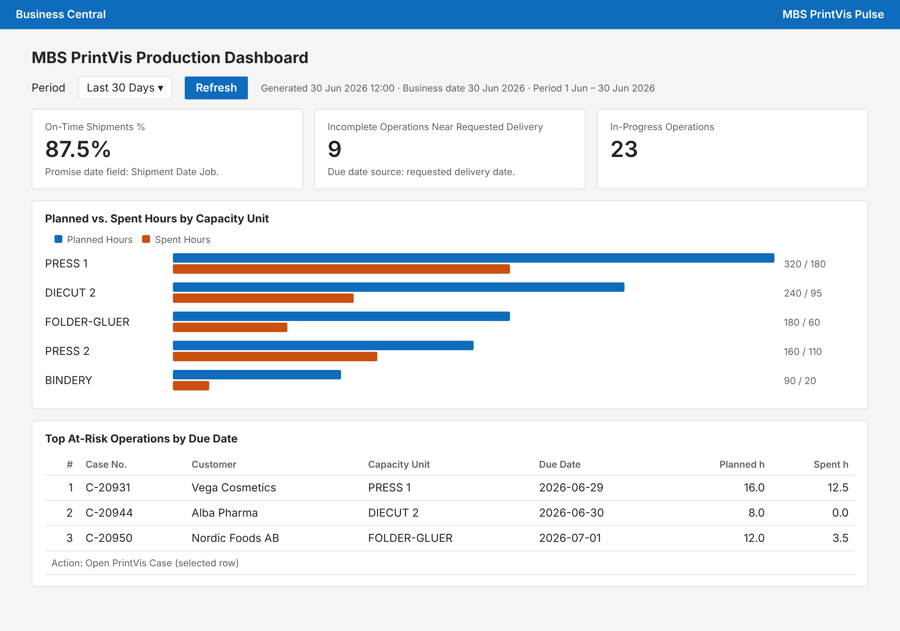
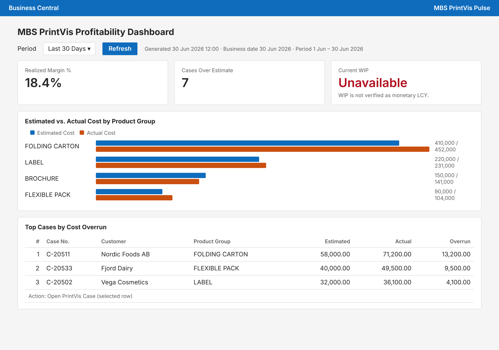

# MBS PrintVis Pulse

Main Business Central Demo PTE for native PrintVis performance dashboards. Part of the [MBS PrintVis Pulse](../README.md) repository.

## Architecture

- **Readers (`50030..50032`) and Runner (`50034`):** each reader raises `OnReadSource` for a PrintVis binding and runs inside `Codeunit.Run`, so a reader error degrades the dashboard to `Unavailable`. The runner also logs refresh telemetry (`MBSPV0001`) and reader failures (`MBSPV0002`) with `TelemetryScope::ExtensionPublisher`.
- **Calculators (`50020..50022`):** pure, deterministic AL logic. They compute KPIs, dynamic captions, `N/A` and `Unavailable` states, top-5 chart JSON, and top-10 ranked exception rows into one bounded snapshot. They never read the clock or the database.
- **Support codeunits (`50023..50025`):** chart JSON builder, period arithmetic, KPI display text.
- **Pages (`50010..50017`):** an optional Role Center (`50010`) with declarative links, three searchable `ListPlus` dashboard hosts (`50011..50013`), the shared KPI `CardPart` (`50014`), and three exception `ListParts` (`50015..50017`).
- **Access:** buffers, readers, runner, calculators, and pages are `Access = Internal` and exposed to `App.Test` through `internalsVisibleTo`.

*Mockup with sample data: host page with period filter, KPI part, chart add-in and exception list part.*

### Object summary

| Range | Area | Objects |
| --- | --- | --- |
| `50000..50007` | Buffers | Snapshot, three input buffers, three exception row tables, chart group buffer (all temporary) |
| `50010..50017` | Pages | Role Center, 3 dashboards, KPI part, 3 exception parts |
| `50020..50025` | Calculators and support | Sales, Production, Profitability calculators, chart JSON, period, display |
| `50030..50034` | Readers and navigation | Sales, Production, Profitability readers, drill-down manager, reader runner |
| `50040..50042` | Enums | Dashboard type, period filter, KPI availability |
| `50050` | Permissions | `MBS PV Pulse Users` (execute rights on Pulse objects only) |
| Control add-in | Visualization | `MBS PV Chart Host` (local vanilla JS and CSS) |
| Profile | Role | `MBS PV Pulse` (optional) |

### KPI rules

| Dashboard | KPI 1 | KPI 2 | KPI 3 |
| --- | --- | --- | --- |
| Sales | Current Open Quotes | Current Open Quote Value (`N/A` on mixed or unverified currency) | Quote Hit Rate % (`N/A` without decisions) |
| Production | On-Time Shipments % (`Unavailable` until the promise field is named) | At-Risk Operations (caption falls back unless an operation-level due date is used) | In-Progress Operations |
| Profitability | Realized Margin % (`N/A` when net sales are not positive) | Cases Over Estimate | Current WIP (`Unavailable` until verified) |

*Profitability: WIP stays `Unavailable` until the binding verifies it.*

## Notes

- **Object ID range:** `50000..50099`.
- **Data contract:** see [`DATA-CONTRACT.md`](DATA-CONTRACT.md) for the PrintVis gates and the reader binding rules.
- **License:** [MIT](../LICENSE)
