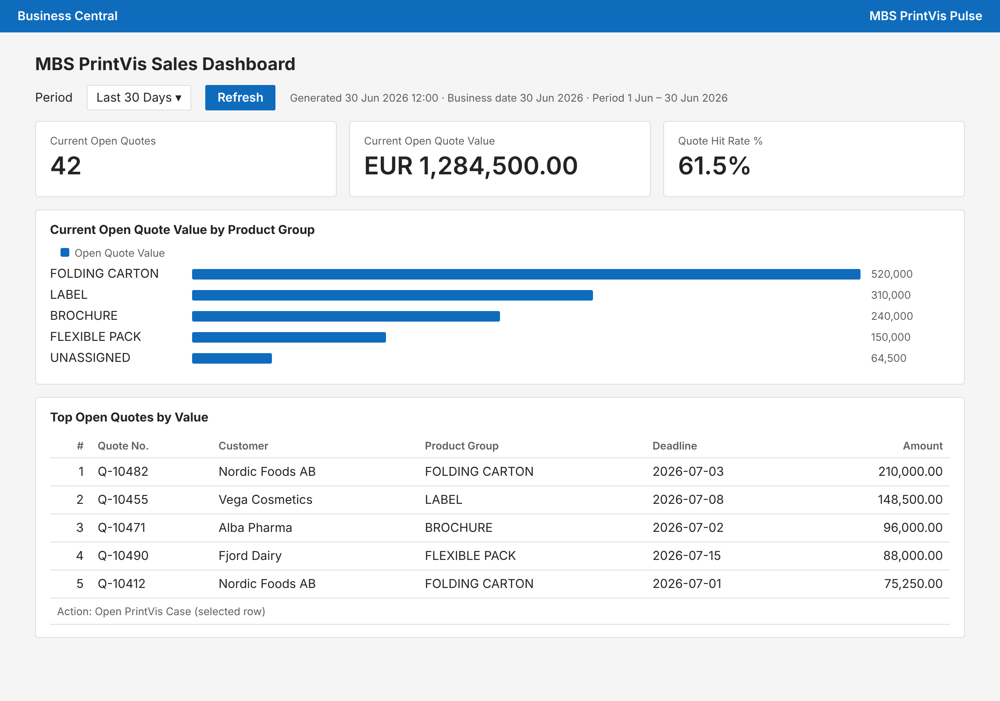
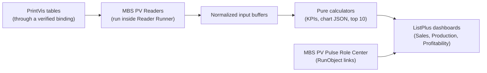
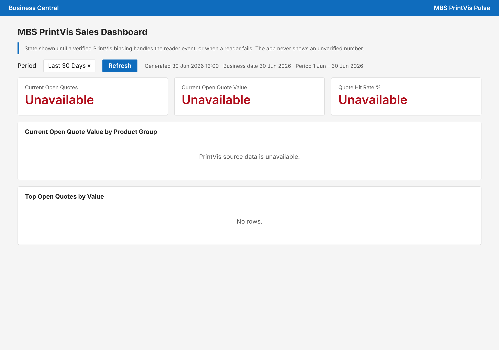
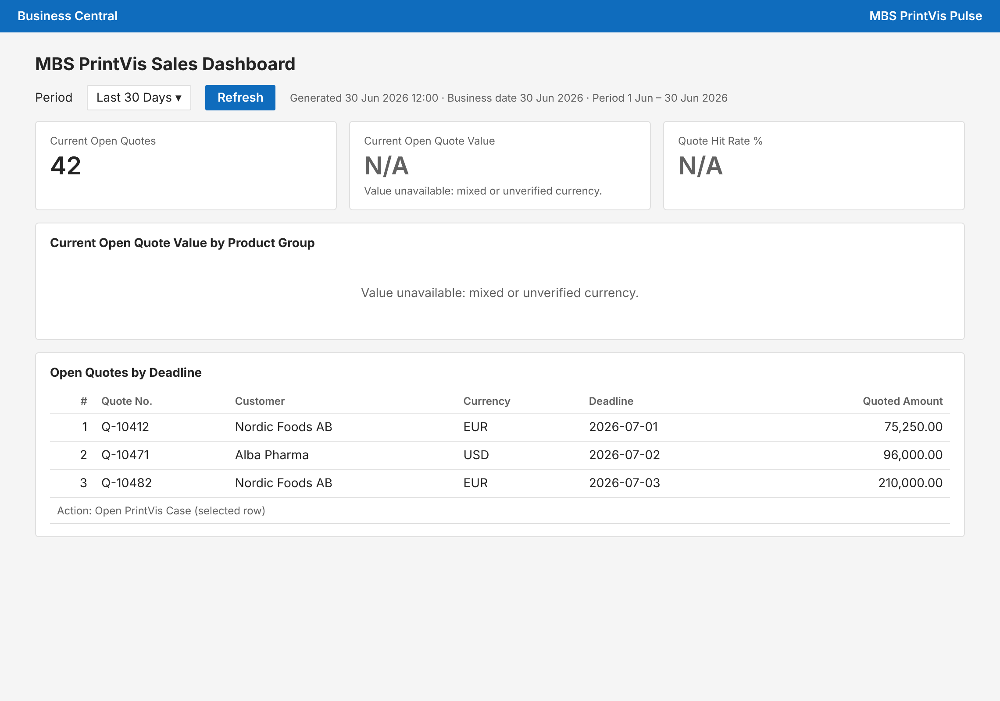

# MBS PrintVis Pulse

A Microsoft Dynamics 365 Business Central Demo Per-Tenant Extension (PTE) that adds three native PrintVis dashboards inside Business Central. Built for Business Central 28.0 or later (`runtime 17.0`) with two AL projects: `App` and `App.Test`.

## Problem

PrintVis stores estimating, production, and job costing data in Business Central. Users often switch to Power BI or open many case cards to answer three daily questions:

- Which open quotes need follow-up?
- Which operations are behind schedule?
- Which print jobs are over estimate?

This app answers those questions inside Business Central with no external BI tool.

*Mockup with sample data. See [`docs/mockups`](docs/mockups/README.md).*

## Why this matters

- **Native Business Central UI:** dedicated searchable `ListPlus` dashboard pages, native KPIs, native exception lists, and one locally packaged vanilla-JS chart control add-in.
- **No external dependencies:** runs inside Business Central SaaS with zero CDN calls and no Power BI setup.
- **Testable AL architecture:** PrintVis readers are separate from pure calculation codeunits, so automated tests verify the real KPI formulas.

## Architecture

**Boundaries:**

- Read-only against PrintVis data. Pulse never modifies PrintVis tables.
- Permissions: Pulse grants execute rights on Pulse objects. PrintVis data access follows the user's PrintVis permission sets.
- Unverified KPIs display `Unavailable`. Undefined ratios display `N/A`.
- Target: `Cloud` (SaaS), Business Central 28.0 or later (`runtime 17.0`).

### Dashboards

| Production | Profitability |
|---|---|
|  |  |

### PrintVis binding status

The calculators, pages, chart, permission set, and tests are complete. The PrintVis data contract (gates G0.1 to G0.4 in the implementation specification) can only be verified against the target PrintVis `.app` symbols, which are not part of this repository. Until a verified binding handles the reader events (`OnReadSource` on codeunits 50030 to 50032 and `OnOpenCase` on codeunit 50033), every KPI shows `Unavailable` and `Open PrintVis Case` explains that the card is not verified. The app never shows an unverified number. See [`App/DATA-CONTRACT.md`](App/DATA-CONTRACT.md).

*The state users see until a binding exists, or when a reader fails.*

## Demo steps

**Prerequisites:** a Business Central 28.0 or later SaaS sandbox with `App` published and, for live data, a verified PrintVis binding.

1. Open Tell Me (`Alt+Q`) and search for **MBS PrintVis Sales Dashboard** (or switch the role to **MBS PrintVis Pulse**).
2. Select a period filter and choose **Refresh**.
3. Review the KPI values, the top-5 chart, and the top-10 exception list.
4. Select an exception row and choose **Open PrintVis Case**.

When the currency basis of open quotes is mixed or unverified, the value shows `N/A`, the chart carries the reason, and the list ranks by deadline:

## What is intentionally simple

- Three focused dashboards: Sales, Production, Profitability.
- Bounded foreground refresh. Page Background Tasks only if measured latency requires it.
- One locally packaged vanilla-JS chart control using DOM text APIs.

## Risks and limits

- **Demo PTE:** not packaged or validated for AppSource.
- **PrintVis dependency:** live data needs the verified binding described above.
- **Single-company view:** metrics reflect the current Business Central company.
- **ID range:** `50000..50099` is a common PTE range and can collide with other PTEs. Confirm it with the tenant owner.

## Repository structure

| Path | App / File | Purpose | Object IDs |
| --- | --- | --- | --- |
| [`App`](App/README.md) | MBS PrintVis Pulse | Dashboards, readers, calculators, chart add-in, Role Center | `50000..50099` |
| [`App.Test`](App.Test/README.md) | MBS PrintVis Pulse Test | Unit tests against the production calculators | `50100..50199` |
| [`LICENSE`](LICENSE) | MIT License | Repository license | n/a |

Other folders: `.AL-Go/` and `.github/` hold the AL-Go settings and workflows. `docs/mockups/` holds dashboard mockups. `.reference/` holds the implementation specification.

## Notes

- **Requirements:** Business Central 28.0 or later (`runtime 17.0`).
- **CI/CD (AL-Go):** `CICD.yaml` builds and tests `App` and `App.Test`. `PullRequestHandler.yaml` validates pull requests.
- **License:** [MIT](LICENSE).
