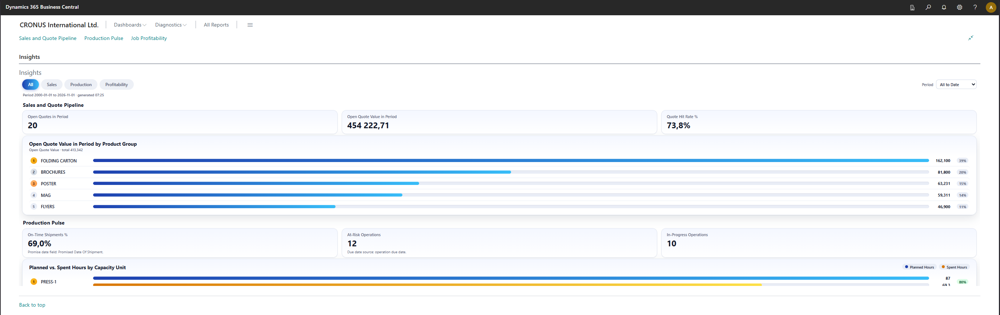
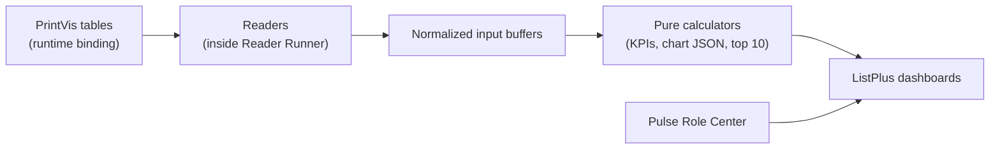
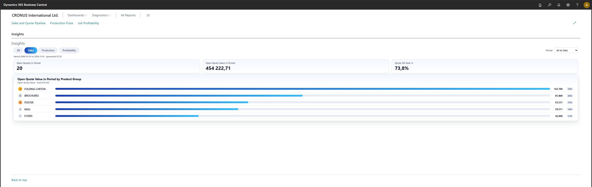
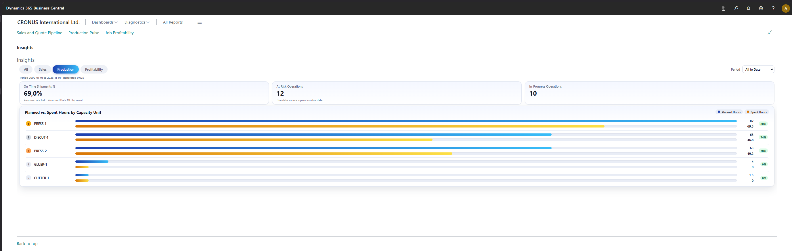
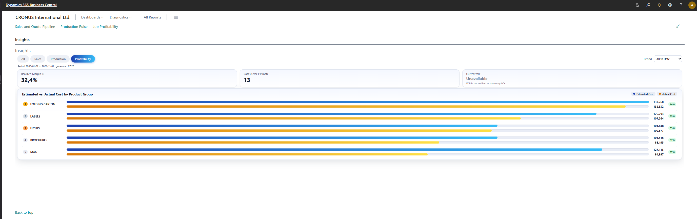
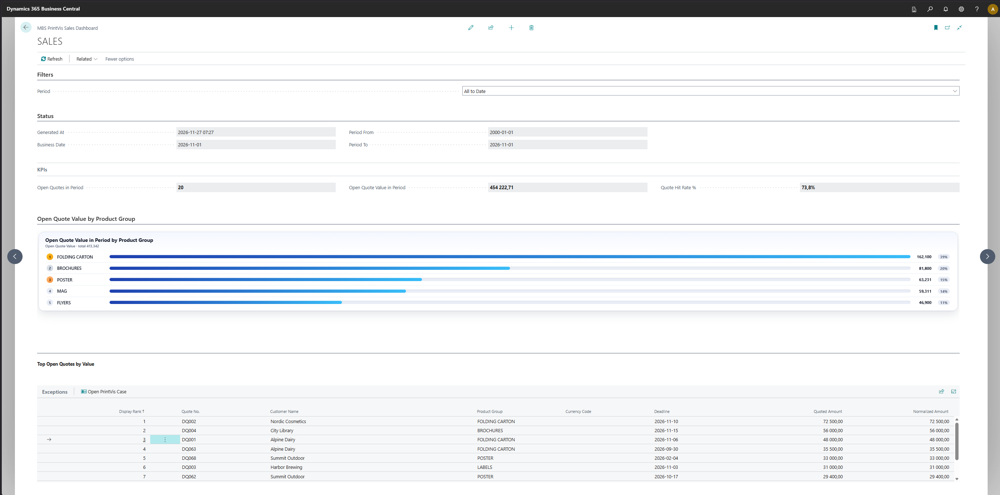
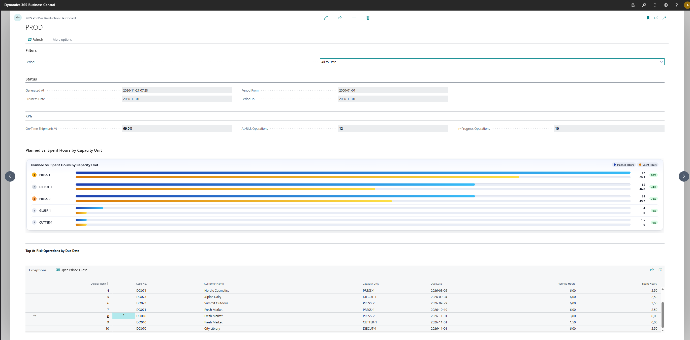
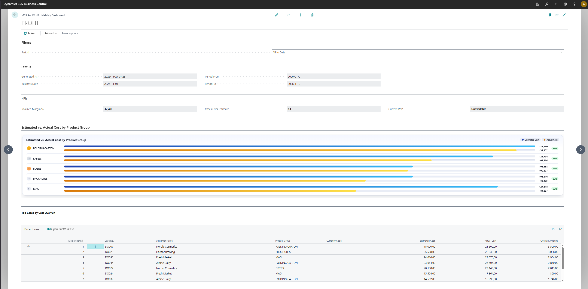

# MBS PrintVis Pulse

A Business Central Per-Tenant Extension (PTE) with three native PrintVis dashboards: Sales, Production, and Profitability. It needs Business Central 28.0 or later (`runtime 17.0`) and has three AL projects: `App`, `App.Test`, and `App.Dataset`.

It is also a **showcase of Business Central control add-ins**. The dashboards draw their charts with one small, locally packaged add-in. See [Control add-in showcase](#control-add-in-showcase).

## Problem

PrintVis keeps estimating, production, and job costing data in Business Central. To answer three daily questions, users often switch to Power BI or open many case cards:

- Which open quotes need follow-up?
- Which operations are behind schedule?
- Which print jobs are over estimate?

This app answers them inside Business Central, with no external BI tool.

*The Role Center in a CRONUS sandbox with demo data from `App.Dataset`.*

## Why it matters

- **Native UI:** searchable `ListPlus` dashboards, native KPIs and exception lists, and one local chart add-in.
- **No external dependencies:** no CDN calls and no Power BI setup.
- **Testable:** PrintVis readers are separate from pure calculators, so unit tests check the real KPI formulas.

## Architecture

- **Read-only** against PrintVis. Pulse never changes PrintVis data.
- **Permissions:** Pulse grants execute rights on its own objects. PrintVis data access follows the user's PrintVis permissions.
- **Honest numbers:** a KPI without a verified source shows `Unavailable`. An undefined ratio shows `N/A`.
- **Target:** `Cloud` (SaaS).

### Role Center Insights

One tab per dashboard, each with three KPIs and a top-5 chart.

| Sales | Production | Profitability |
|---|---|---|
|  |  |  |

### Dashboard pages

Each page has a period filter, **Refresh**, KPIs, a chart, and a top-10 exception list with **Open PrintVis Case**.

| Production | Profitability |
|---|---|
|  |  |

*Current WIP shows `Unavailable` because it is not verified as monetary LCY.*

### PrintVis binding status

PrintVis is not a compile-time dependency. `App` finds PrintVis tables and fields by name at runtime with `RecordRef` (`App/src/Binding`).

| Area | Status |
|---|---|
| Sales reader (codeunit 50030) | Bound. Reads `PVS Case`. |
| Case drill-down (codeunit 50033) | Bound. |
| Production reader (codeunit 50031) | Binding pending. Shows `Unavailable`. |
| Profitability reader (codeunit 50032) | Binding pending. Shows `Unavailable`. |
| Current WIP | Not verified. Shows `Unavailable`. |

The Production and Profitability screenshots come from a sandbox with demo data. A dashboard without a binding, or with a failing reader, shows `Unavailable`. Details are in [`App/DATA-CONTRACT.md`](App/DATA-CONTRACT.md).

## Control add-in showcase

This repository shows how a PTE can ship a **custom visual with a control add-in** and keep it small, testable, and safe.

| Piece | Choice | Why |
|---|---|---|
| Definition | AL `controladdin` `MBS PV Chart Host` | The supported way to host custom UI in the web client. No extra build step. |
| Script | One vanilla JavaScript file (about 80 lines) and one CSS file | Nothing to update or review besides our own code. |
| AL to JS | `RenderBarChart(ChartJson)` and event `OnControlReady()` | A small interface. AL builds a bounded JSON payload. The script only draws it. |
| Rendering | DOM text APIs, no `innerHTML` with data | Data from PrintVis is never read as HTML. |
| Styling | CSS bars | A top-5 bar chart needs no charting library. |
| Packaging | Files inside the `.app` | Works in locked-down tenants. No CDN, no downloads at runtime. |

The same add-in draws all three charts. Pages place it in a `usercontrol` and call `RenderBarChart` after each refresh.

### Security note: external components in add-ins

A control add-in runs JavaScript in the web client, in the signed-in user's session. So everything an add-in loads deserves extra care. AI-assisted attacks are getting more common (faster discovery of weak points, automated scanning of public packages), which makes this a good time to review it.

What this project does:

- **Bundles everything locally.** No CDN links, external fonts, or calls to other hosts.
- **Uses no third-party packages.** No npm dependencies, so no transitive supply-chain risk.
- **Treats data as text.** No `innerHTML`, `eval`, or dynamic script loading.
- **Keeps the interface small.** Only `RenderBarChart` and `OnControlReady`.

If you build an add-in with external components, consider:

1. Bundle instead of loading from a CDN. Pin an exact version and record its source and license.
2. Review what you bundle (source, maintainers, hashes) and update it on a schedule.
3. Keep third-party code to a minimum.
4. Respect the platform's isolation. If an external host is truly needed, agree it with the tenant owner and check current Microsoft guidance.
5. Never put secrets in add-in code. Every user can read it.
6. Review add-in changes like other code, and scan dependencies and secrets in CI.

This is general information, not a compliance statement. For tenant decisions, please involve your security team. See also [`SECURITY.md`](SECURITY.md).

## Demo steps

**Prerequisites:** a Business Central 28.0 or later SaaS sandbox with `App` published. For data, publish `App.Dataset` or use a PrintVis binding.

1. Open Tell Me (`Alt+Q`) and search for **MBS PrintVis Sales Dashboard**, or switch to the **MBS PrintVis Pulse** role.
2. Choose a period and select **Refresh**.
3. Review the KPIs, the chart, and the exception list.
4. Select a row and choose **Open PrintVis Case**.

## Scope and limits

- Three focused dashboards. Foreground refresh, bounded in size.
- **Demo PTE:** not validated for AppSource.
- **Single company:** metrics cover the current company.
- **ID range:** `50000..50099` is a common PTE range and can collide with other PTEs. Check it with the tenant owner.

## Repository structure

| Path | Purpose | Object IDs |
| --- | --- | --- |
| [`App`](App/README.md) | Dashboards, readers, calculators, chart add-in, Role Center | `50000..50099` |
| [`App.Test`](App.Test/README.md) | Unit tests against the real calculators | `50100..50199` |
| [`App.Dataset`](App.Dataset/README.md) | Sandbox demo data with a log and one-run cleanup | `50200..50299` |

`.AL-Go/` and `.github/` hold the AL-Go settings and workflows. `docs/images/` holds the screenshots. CI/CD builds all three apps and runs the tests. License: [MIT](LICENSE).
